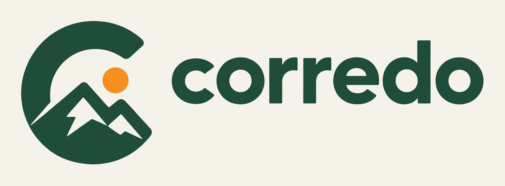
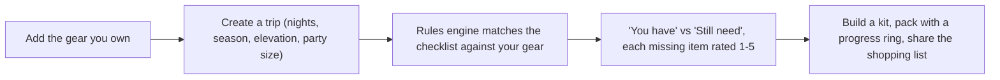

  

  
<strong>Your kit, ready for the trail.</strong>

     

> **Showcase repository.** The source code for Corredo is not published. This page presents what the product is and how it works.

## Overview

A native iPhone/iPad app for keeping a gear inventory, building reusable packing kits, and getting an on-device pack guide for a trip, including trips sent from Stellata.

## How it works

## Features

- My Gear: category, brand, condition, cost, warranty, maintenance intervals
- Kits: reusable packing lists with checklist and progress ring
- Trips + deterministic pack guide with Essential / Recommended / Nice-to-have ratings
- Weight totals, party-size scaling, trip countdowns, merged shopping list
- Stellata link (corredo://trip) that always asks before saving
- JSON backup/restore, formula-safe CSV export, four color themes, dark mode

## Tech stack

| Layer | Choice |
|---|---|
| Language / UI | Swift, SwiftUI, SwiftData, iOS 17+ |
| Dependencies | None (no packages, no network) |
| Docs | ARCHITECTURE, SECURITY, PRIVACY, TESTING, CHANGELOG |
| Tests | CorredoTests (unit) |

## Privacy & security

No network, no accounts, no analytics. Everything is on-device; URL-scheme input is treated as untrusted.

## Brand

| | Name | Hex | Role |
|---|---|---|---|
|  | Forest | `#1F4D3A` | Primary |
|  | Sage | `#97A88F` | Secondary |
|  | Sun | `#F4A261` | Accent |
|  | Earth | `#8B5E3C` | Warm neutral |
|  | Sand | `#EDE8DF` | Light surface |

**Mark.** A "C" formed by mountains and a sun, set in a lowercase rounded wordmark.

**Voice.** Confident and friendly: "pack well".

## Roadmap

- Photos
- iCloud sync
- Maintenance notifications
- Widgets and barcode scanning
- Review of guide rules by a backpacking expert

## Notes

Companion app: [Stellata](https://github.com/Steven6Brown/Stellata). Formerly GearGrid / Kitwise.

## License

Proprietary. Shared publicly for portfolio and demonstration purposes only. See [LICENSE](LICENSE).

---

Built by [Aquila Digital LLC](https://github.com/Steven6Brown) · *Per Aspera Ad Astra*

